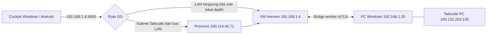

# Rancangan deployment data nyata

Rancangan ini mengikuti topologi dan kontrak yang dikonfirmasi pengguna. Implementasi client tersedia di repository; pengujian pada perangkat dan jaringan pengguna masih diperlukan.

## Alamat dan peran

Server dan PC berada pada LAN yang sama dengan gateway `192.168.1.1`. Server Hermes adalah VM di atas Proxmox. Proxmox mengiklankan subnet route melalui Tailscale. IP tailnet Proxmox tidak menjadi endpoint alternatif API VM.

Windows pada PC sendiri, Windows lain, dan Android mengakses workspace yang sama melalui API VM. Agent dan collector melapor ke backend, kemudian client membaca snapshot/event. Identitas node `pc` tetap sama pada semua client. Menginstal client baru tidak otomatis mendaftarkan node execution baru.

Alamat tujuan tidak perlu berubah ketika berpindah LAN/Tailscale. OS dan Tailscale mengatur jalur menuju `192.168.1.4`. Aplikasi melakukan timeout, snapshot ulang, meminta tiket baru, dan reconnect WebSocket ketika jalur terputus. UI tidak menampilkan label jalur aktual yang belum dapat dibuktikan.

Pengguna perlu memastikan subnet route disetujui, client menerima rute, dan kebijakan tailnet mengizinkan akses. Pada LAN, periksa bahwa rute lokal yang diinginkan diprioritaskan. Jaringan berbeda yang juga memakai `192.168.1.x` dapat bertabrakan dengan subnet rumah; kasus itu perlu pemeriksaan rute atau deployment endpoint HTTPS tersendiri. Client tidak mengubah routing OS secara diam-diam.

## Kondisi backend yang dilaporkan

- FastAPI + Uvicorn Python 3.12 berjalan melalui PM2 `hermes-cockpit`, ID 13.
- PostgreSQL 17, database `hermes_cockpit`, memiliki tabel spec v1.
- Port `3450`: API client dan telemetry; port `8795`: node bridge mTLS.
- Health live/ready dilaporkan ok oleh pengguna; cloud belum dapat memverifikasinya.
- Node `pc` terdaftar tetapi offline karena worker `hermes-node` belum terhubung.
- Metrik hardware PC dan server masih null/stale. Client kini menampilkan keadaan itu secara langsung.
- `/api/status` memuat status runtime/session/skills/provider; endpoint itu tidak menjadi sumber angka hardware buatan.

## Perubahan client yang sudah dibuat

1. Menghapus state awal demo, balasan chat simulasi, mission/feed contoh, log palsu, angka token tebakan, profil pengguna contoh, spesifikasi GPU, serta metrik hardware statis.
2. Memakai bootstrap, session, mission, approval/question, traces/log, serta EventEnvelope backend.
3. Membedakan belum dipasangkan, menghubungkan, terhubung, reconnect, offline, dan pairing diperlukan. Snapshot terputus ditandai sebagai data lama.
4. Memakai transport HTTP/WebSocket native untuk Windows/Android. HTTP dibatasi ke VM dalam capability; CSP WebView tetap membatasi koneksi langsung.
5. Menyatukan refresh token bersamaan, menjaga rotasi, tidak mengulang mutasi yang hasilnya belum diketahui, dan memakai tiket baru setiap reconnect.
6. Menjalankan kontrol daya melalui backend dengan konfirmasi pengguna, tanpa optimisme status palsu; approval dan pertanyaan terikat pada hash yang ditinjau.
7. Memperbaiki ripple filter agar tap mobile tidak mengubah layout tombol.

## Yang diperlukan di server dan PC

Worker Windows harus dijalankan dengan file `C:\ProgramData\hermes-node\node.yaml` dan sertifikat yang diterbitkan backend. Desktop helper mengikuti konfigurasi Task Scheduler/Named Pipe yang telah ditentukan sistem. Backend juga perlu collector hardware Linux bila CPU/RAM/disk server ingin tersedia. Komponen tersebut tidak berada di source repository client ini; tidak ada worker atau sertifikat palsu yang dibuat untuk membuat monitoring tampak online.

## Pemeriksaan pada perangkat asli

| Skenario | Hasil yang harus diperiksa |
| --- | --- |
| Windows PC sendiri pada LAN | Node PC yang sama; VM API terjangkau dan rute lokal dipilih sesuai tabel routing |
| Windows lain pada LAN | Workspace sama setelah pairing, tanpa worker baru otomatis |
| Android Wi-Fi LAN | Pairing, snapshot, telemetry native, dan perpindahan halaman berfungsi |
| Android data seluler + Tailscale | Subnet route mencapai VM pada URL yang sama |
| Windows di luar LAN + Tailscale | Rute menuju VM aktif dan akses tailnet diizinkan |
| LAN/Tailscale terputus lalu pulih | Data lama ditandai; reconnect tidak menggandakan event atau tugas |
| Worker PC belum berjalan | Backend tetap online, PC offline, metrik kosong |
| Worker PC diaktifkan | Status mengikuti heartbeat; metrik hanya muncul jika benar-benar dikirim |
| Jaringan luar memiliki subnet sama | Periksa rute agar token/permintaan tidak menuju perangkat LAN lain |

Backend pengguna belum bisa dijangkau dari cloud: proxy mengembalikan `403 Domain forbidden`. Hasil pengujian fixture dan kompilasi ada di `VALIDATION.md`; keduanya tidak membuktikan koneksi LAN/Tailscale pada perangkat asli.
